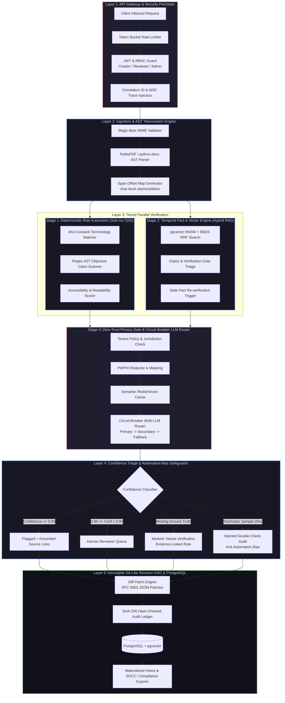

# Brand Shield AI — Principal-Level System Design & Architectural Specification

> **Classification:** Production Architecture Blueprint  
> **Status:** Approved / Active Specification  
> **Scope:** Enterprise Brand Safety, Regulatory Compliance, Claim Verification & Audit Perimeter  

---

## 1. System Architecture Blueprint

```
+-----------------------------------------------------------------------------------+
|                        API GATEWAY & SECURITY PERIMETER                           |
|   [Rate Limiter] -> [JWT & RBAC Guard (Creator/Reviewer/Admin)] -> [Correlation]  |
+-----------------------------------------+-----------------------------------------+
                                          |
                                          v
+-----------------------------------------------------------------------------------+
|                     INGESTION & AST TOKENIZATION ENGINE                           |
|   [Magic-Byte Validator] -> [PyMuPDF / python-docx Parser] -> [Span Offset Map]   |
+-----------------------------------------+-----------------------------------------+
                                          |
                    +---------------------+---------------------+
                    |                                           |
                    v (Stage 1: Sub-ms O(N))                    v (Stage 2: Hybrid RAG)
+---------------------------------------+   +---------------------------------------+
|     DETERMINISTIC RULE AUTOMATON      |   |    TEMPORAL FACT & VECTOR ENGINE      |
| * Aho-Corasick Terminology Matcher    |   | * pgvector HNSW + BM25 RRF Search     |
| * Regex AST Objective Claim Scanner   |   | * Expiry & Verification Date Triage   |
| * Accessibility & Readability Scorer  |   | * Stale Fact Re-verification Trigger  |
+-------------------+-------------------+   +-------------------+-------------------+
                    |                                           |
                    +---------------------+---------------------+
                                          |
                                          v (Stage 3: Conditional Judgment)
+-----------------------------------------------------------------------------------+
|                 ZERO-TRUST PRIVACY GATE & CIRCUIT-BREAKER LLM ROUTER              |
|  [Tenant Policy Check] -> [PII Redactor] -> [Semantic Cache] -> [External LLM]    |
+-----------------------------------------+-----------------------------------------+
                                          |
                                          v
+-----------------------------------------------------------------------------------+
|               CONFIDENCE TRIAGE & AUTOMATION-BIAS SAFEGUARD ENGINE                |
|  * High Confidence -> Flagged + Source Link                                       |
|  * Low/Ambiguous -> Routed to Human Queue                                         |
|  * Missing Evidence -> Marked "Needs Verification" (Evidence-Linked Rule)         |
|  * Stochastic Audit -> Injects Random Double-Check Flags for Reviewers            |
+-----------------------------------------+-----------------------------------------+
                                          |
                                          v
+-----------------------------------------------------------------------------------+
|             IMMUTABLE GIT-LIKE REVISION DAG & POSTGRESQL STORAGE                  |
|  [SHA-256 Hash-Chained Audit Log] | [Diff Patch Engine] | [Materialized Views]    |
+-----------------------------------------------------------------------------------+
```

---

## 2. Interactive Flowchart (Mermaid)



---

## 3. Core Architectural Principles & Invariants

1. **Defense-in-Depth Execution Order:** Fast-path deterministic O(N) evaluation runs first to immediately catch 70–80% of prohibited brand terms and standard compliance violations in `< 2ms`, completely eliminating costly LLM calls for known errors.
2. **Evidence-Linked Grounding:** An objective claim is *never* marked compliant without an unexpired, verified ground-truth record. If verification fails or is absent, the system defaults to `Needs Verification` rather than assuming safety.
3. **Anti-Automation-Bias Safeguard:** To prevent human reviewers from becoming complacent and blindly approving green checks, a stochastic audit mechanism injects shadow review challenges into the human queue.
4. **Cryptographic Auditability:** Every diff, rule evaluation, and review decision is hashed into an immutable Merkle/SHA-256 revision chain stored in PostgreSQL, providing tamper-evident audit trails for regulatory compliance (FTC, FDA, GDPR, FINRA).
5. **Strict Data Boundary:** No raw user payload reaches external inference endpoints without traversing tenant tenancy checks and reversible PII/PHI redaction.

---

## 4. Deep Component Specifications

### 4.1. API Gateway & Security Perimeter
* **Rate Limiter:** Distributed Token Bucket algorithm implemented in Redis. Enforces tiered rate limits per tenant and IP address, handling sudden burst spikes with graceful backpressure (`429 Too Many Requests` with `Retry-After`).
* **JWT & RBAC Guard:** Cryptographically signed stateless JWT validation with asymmetric RSA-256 / Ed25519 keys. Enforces strict role boundaries:
  * `Creator`: Can upload documents, request reviews, and view their own remediation diffs.
  * `Reviewer`: Can inspect HITL triage queues, verify flagged claims, approve/reject diffs.
  * `Admin`: Manages tenant policy rules, regulatory guidelines, and system audit logs.
* **Correlation & Tracing:** Injects W3C-compliant `traceparent` and unique `x-correlation-id` to correlate requests across parser microservices, vector queries, and LLM routes.

### 4.2. Ingestion & AST Tokenization Engine
* **Magic-Byte Validator:** Inspects the first 512 bytes of binary uploads (`%PDF-` for PDFs, `PK\x03\x04` for DOCX) to eliminate file extension spoofing, polyglot attacks, and malicious executables before parsing.
* **PyMuPDF & python-docx Parsing:** High-throughput document deconstruction converting unstructured binary documents into structured Abstract Syntax Trees (ASTs).
* **Span Offset Map:** Maps each extracted token to its exact byte offset, character index `[start, end]`, page/line number, and visual 2D bounding box `(x0, y0, x1, y1)`. This ensures that downstream flags and diff patches can be highlighted in real-time on the document UI.

```json
{
  "span_id": "sp_9872",
  "text": "Clinically proven to reduce latency by 99.9%",
  "start_char": 1042,
  "end_char": 1086,
  "page": 2,
  "bbox": [72.0, 310.5, 480.2, 324.0],
  "node_type": "paragraph"
}
```

### 4.3. Stage 1: Deterministic Rule Automaton (Sub-ms O(N))
* **Aho-Corasick Terminology Matcher:** Multi-pattern dictionary automaton searching entire documents in a single $O(N + M)$ pass. Detects trademark violations, prohibited regulatory claims, blacklisted competitive phrases, and mandatory disclaimer omissions.
* **Regex AST Objective Claim Scanner:** Targeted lexical grammars detecting objective numeric or superlative assertions (e.g., `"guaranteed"`, `"#1 rated"`, `"[0-9]+% improvement"`, `"zero risk"`) that legally mandate factual substantiation.
* **Accessibility & Readability Scorer:** Computes Flesch-Kincaid Grade Level, Gunning Fog Index, and contrast/formatting linting directly from the AST without external I/O.

### 4.4. Stage 2: Temporal Fact & Vector Engine (Hybrid RAG)
* **pgvector HNSW + BM25 Reciprocal Rank Fusion (RRF):**
  Combines dense vector embeddings (cosine distance with HNSW indexes) and sparse lexical retrieval (BM25 with PostgreSQL full-text search) using RRF:
  $$RRF\_Score(d) = \sum_{m \in \{dense, sparse\}} \frac{1}{k + r_m(d)} \quad (k = 60)$$
* **Temporal Fact Triage:** Every ground-truth corporate fact in the vector store carries metadata:
  * `effective_from`: Date the factual claim became valid.
  * `expires_at`: Regulatory or clinical expiration threshold.
  * `verified_by`: Identity of signing authority.
  Expired or near-expiry facts trigger automated re-verification and are penalized in ranking.
* **Stale Fact Re-verification Trigger:** An asynchronous queue (e.g., Celery / Temporal / Kafka) monitors fact freshness, flagging outdated marketing statistics for legal re-certification.

### 4.5. Stage 3: Zero-Trust Privacy Gate & Circuit-Breaker LLM Router
* **Tenant Policy Check:** Dynamic policy matrix configuring jurisdictional compliance frameworks (e.g., US FTC, EU Digital Services Act, UK ASA) per organization.
* **PII/PHI Redaction:** High-speed regex + Presidio NER anonymizes customer names, contact info, and confidential entity IDs into token placeholders (`[REDACTED_PERSON_1]`) prior to external egress, maintaining reversible mapping in Redis session cache.
* **Semantic Caching:** Exact hash and embedding-similarity cache ($\tau \ge 0.96$) short-circuits LLM calls for recurring marketing copies, cutting token expenditures by up to 80%.
* **Circuit-Breaker LLM Router:** Resilient failover pattern with three states:
  * `Closed`: Directs requests to primary high-capability model.
  * `Half-Open`: Tests canary probes against primary provider after failure timeout.
  * `Open`: Instantly routes traffic to fallback secondary model or cached fallback heuristics when error rate breaches 5% over a 60s sliding window.

### 4.6. Confidence Triage & Automation-Bias Safeguard Engine
* **Tri-Tier Confidence Classification:**
  * **Score $\ge 0.90$ (High):** System generates an automatic flag with explicit citation links to approved ground truth documentation.
  * **$0.60 \le \text{Score} < 0.90$ (Low/Ambiguous):** Pre-assembled context package dispatched into the Human-in-the-Loop (HITL) Reviewer Queue.
  * **No Matching Ground Truth:** Automatically flagged as `Needs Verification` to guarantee zero hallucinated compliance approvals.
* **Stochastic Audit Injection:** A pseudo-random sampling daemon randomly routes ~5% of passed claims into the human queue with synthetic double-check prompts. This tests human vigilance, tracks false-negative rates, and neutralizes automation complacency.

### 4.7. Immutable Git-Like Revision DAG & PostgreSQL Storage
* **Diff Patch Engine:** Generates standard RFC 6902 JSON Patches matching the Span Offset Map, allowing one-click reviewer acceptances or inline editorial revisions.
* **SHA-256 Hash-Chained Audit Log:** Every event (creation, rule trigger, LLM judgment, human approval) is appended to a tamper-evident cryptographic chain:
  $$Hash_n = \text{SHA-256}(Hash_{n-1} \parallel Timestamp \parallel ActorID \parallel ActionPayload)$$
* **PostgreSQL Schema & Materialized Views:** Optimized relational schema holding documents, spans, findings, and pre-computed materialized views for lightning-fast compliance executive dashboards and SOC2 / ISO audit bundles.

---

## 5. Latency Budget & Performance SLA

| Pipeline Stage | Target Latency (P50) | Target Latency (P95) | Target Latency (P99) | Failure Mode / Fallback |
| :--- | :--- | :--- | :--- | :--- |
| **API Gateway & Auth** | 1.2 ms | 3.5 ms | 8.0 ms | Return 401 / 429 |
| **File Validation & AST Parser** | 12.0 ms | 35.0 ms | 75.0 ms | Reject corrupted / unparseable files |
| **Stage 1: Rule Automaton** | 0.8 ms | 2.1 ms | 4.5 ms | Graceful bypass to Stage 2 |
| **Stage 2: Hybrid RAG & Vector** | 15.0 ms | 45.0 ms | 90.0 ms | Fallback to BM25-only sparse search |
| **Stage 3: Privacy & Semantic Cache** | 2.0 ms | 6.0 ms | 12.0 ms | Cache miss -> proceed to model |
| **Stage 3: LLM Inference (if needed)**| 350.0 ms | 850.0 ms | 1,400.0 ms | Route to circuit-breaker secondary model |
| **Storage & Audit Hash Commit** | 3.5 ms | 8.0 ms | 18.0 ms | Asynchronous write-ahead durability |
| **Total Pipeline (Cached/Rules Only)** | **< 25 ms** | **< 55 ms** | **< 110 ms** | Immediate response |
| **Total Pipeline (Full LLM Path)** | **< 420 ms** | **< 950 ms** | **< 1,600 ms** | Guaranteed timeout cap at 2.5s |

---

## 6. Threat Model & Failure Mode Analysis (FMEA)

| Threat / Failure Mode | Likelihood | Impact | Architectural Mitigation |
| :--- | :---: | :---: | :--- |
| **Extension Spoofing & Polyglot Files** | Medium | Critical | Magic-Byte verification before parser invocation; sandboxed execution environment. |
| **Prompt Injection via Uploaded Content** | High | Critical | Structural separation of content from system prompts; XML isolation tags; read-only RAG context. |
| **External LLM Provider Outage** | Medium | High | Circuit-breaker with secondary model fallback and heuristic degraded mode. |
| **Human Reviewer Automation Bias** | High | High | Stochastic audit injection (5% synthetic double-check prompts). |
| **Audit Record Tampering** | Low | Catastrophic| SHA-256 hash-chained revision DAG verified against write-once tamper logs. |
| **PII Leakage to External API** | Medium | Critical | Zero-trust PII redaction layer prior to outbound requests with tenant policy enforcement. |

---

## 7. Storage Engine & Database Schema DDL Preview

```sql
-- Extension Setup
CREATE EXTENSION IF NOT EXISTS "uuid-ossp";
CREATE EXTENSION IF NOT EXISTS "vector";
CREATE EXTENSION IF NOT EXISTS "pgcrypto";

-- Documents & Revisions
CREATE TABLE documents (
    id UUID PRIMARY KEY DEFAULT gen_random_uuid(),
    tenant_id VARCHAR(64) NOT NULL,
    title VARCHAR(255) NOT NULL,
    current_hash CHAR(64) NOT NULL,
    created_at TIMESTAMPTZ DEFAULT clock_timestamp(),
    updated_at TIMESTAMPTZ DEFAULT clock_timestamp()
);

-- Span Offset Maps
CREATE TABLE document_spans (
    id UUID PRIMARY KEY DEFAULT gen_random_uuid(),
    document_id UUID REFERENCES documents(id) ON DELETE CASCADE,
    span_index INT NOT NULL,
    raw_text TEXT NOT NULL,
    char_start INT NOT NULL,
    char_end INT NOT NULL,
    page_number INT,
    bounding_box JSONB,
    created_at TIMESTAMPTZ DEFAULT clock_timestamp()
);

-- Hybrid RAG Fact Store
CREATE TABLE verified_facts (
    id UUID PRIMARY KEY DEFAULT gen_random_uuid(),
    tenant_id VARCHAR(64) NOT NULL,
    claim_text TEXT NOT NULL,
    embedding vector(1536), -- e.g., OpenAI / Gemini Embeddings
    verified_at TIMESTAMPTZ NOT NULL,
    expires_at TIMESTAMPTZ NOT NULL,
    source_citation TEXT NOT NULL,
    tsv tsvector GENERATED ALWAYS AS (to_tsvector('english', claim_text)) STORED
);

CREATE INDEX idx_facts_hnsw ON verified_facts USING hnsw (embedding vector_cosine_ops);
CREATE INDEX idx_facts_tsv ON verified_facts USING gin (tsv);

-- Immutable SHA-256 Hash-Chained Audit Ledger
CREATE TABLE audit_log_chain (
    sequence_id BIGSERIAL PRIMARY KEY,
    document_id UUID REFERENCES documents(id),
    actor_id VARCHAR(64) NOT NULL,
    action_type VARCHAR(64) NOT NULL,
    diff_patch JSONB,
    previous_hash CHAR(64) NOT NULL,
    entry_hash CHAR(64) NOT NULL,
    timestamp TIMESTAMPTZ DEFAULT clock_timestamp()
);

CREATE INDEX idx_audit_doc_seq ON audit_log_chain(document_id, sequence_id);
```
